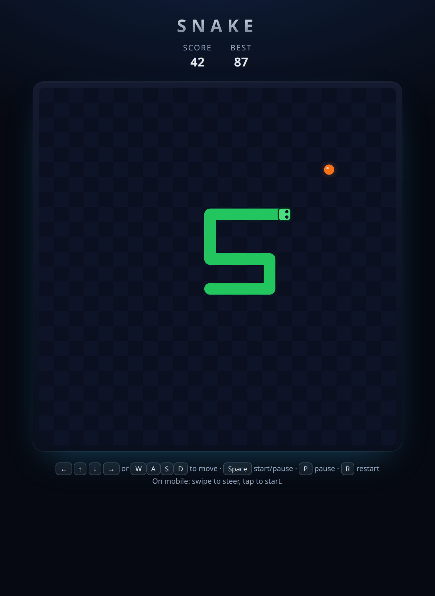
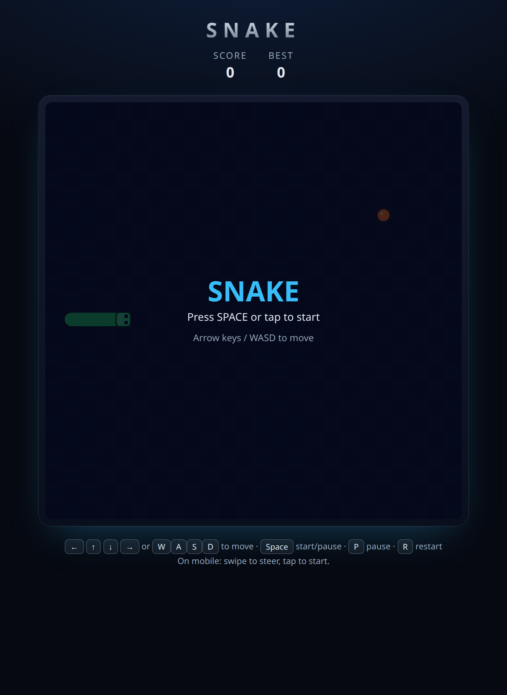
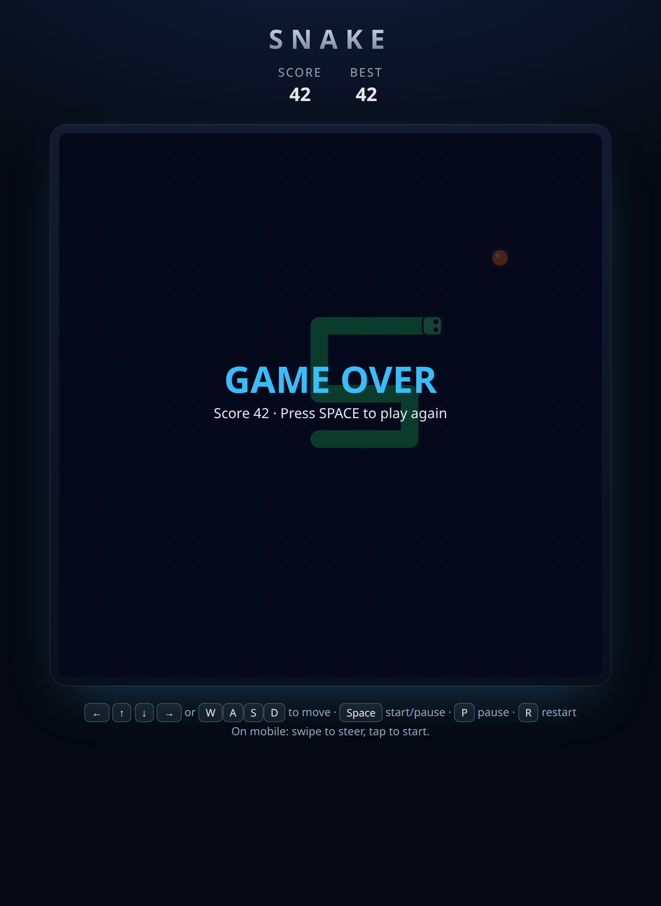

# Snake 🐍 (TypeScript)

A classic Snake game built with **TypeScript** and the HTML5 Canvas — no
frameworks, no runtime dependencies.

  

## How this was made

Built end-to-end by the **[Pi coding agent](https://github.com/earendil-works/pi-coding-agent)**
paired with a **locally hosted open-weight model** — no cloud AI. The agent planned
the module layout, wrote the TypeScript, compiled it, ran the headless tests, and
pushed the repo.

| | |
| --- | --- |
| Agent | Pi coding agent (`PI_CODING_AGENT=true`) |
| Model alias | `dgx-deepseek-v4.1` |
| Base model | [`deepseek-ai/DeepSeek-V4.1-Flash`](https://huggingface.co/deepseek-ai) |
| Serving | vLLM, tensor-parallel **TP=3** across **3× NVIDIA DGX Spark** (GB10 Grace Blackwell, aarch64) |
| Access | LiteLLM gateway (OpenAI-compatible `/v1`), self-hosted so usage is logged at **$0** |

> In short: everything ran on a small local DGX cluster, and the model was reached
> through a unified LiteLLM proxy rather than any hosted API.

## Screenshots



| Start screen | Game over |
| --- | --- |
|  |  |

These are captured from the real, rendered game with headless Chromium via
`npm run screenshots` (Playwright) — not mockups. The page accepts
`?demo=playing` / `?demo=gameover` to freeze a deterministic scene for capture.

## Features

- Grid-based snake with smooth, rounded rendering and animated food
- Arrow keys or **WASD** to steer; turns are queued so fast inputs never drop
- Space / tap to start & pause, **P** to pause, **R** to restart
- Progressive speed-up every 5 points
- Score + persistent high score (`localStorage`)
- Touch controls: swipe to steer, tap to start
- Wall and self collision, but following your own tail is allowed

## Getting started

```bash
npm install        # installs the TypeScript compiler
npm run build      # compiles src/ -> dist/
npm start          # serves at http://localhost:5173
```

Or in one step:

```bash
npm run dev
```

Then open <http://localhost:5173>.

If port 5173 is already taken (e.g. by a Vite dev server), the server
automatically tries the next free port and prints it. Set an explicit port with
`PORT=3000 npm start` to fail-fast instead.

## Scripts

| Command         | Description                                  |
| --------------- | -------------------------------------------- |
| `npm run build` | Type-check and compile `src/` to `dist/`     |
| `npm run watch` | Recompile on change                          |
| `npm test`      | Build, then run the headless logic tests     |
| `npm run screenshots` | Build, then capture the README screenshots |
| `npm start`     | Serve the built game on port 5173            |
| `npm run dev`   | Build once, then serve                       |

## Project layout

```
index.html          Markup, scores and styling
server.mjs          Tiny zero-dependency static file server
src/
  types.ts          Shared types, direction helpers
  snake.ts          Snake entity: movement, growth, collision
  game.ts           Rules, scoring, game state machine, loop ticking
  renderer.ts       All canvas drawing (board, snake, food, overlays)
  input.ts          Keyboard + touch input handling
  demo.ts           Deterministic scenes for screenshots (?demo=...)
  main.ts           Wires everything together and runs the rAF loop
test/
  logic.test.mjs    Headless tests for the game rules
scripts/
  screenshots.mjs   Playwright capture of the README images
screenshots/        Generated PNGs used by this README
```

Game logic is deliberately decoupled from rendering (`Renderer`) and input
(`InputManager`), so the rules can be tested headlessly with Node.

## Controls

| Action  | Keys                       |
| ------- | -------------------------- |
| Move    | Arrow keys / WASD / swipe  |
| Start   | Space / Enter / tap        |
| Pause   | Space / Enter / P          |
| Restart | R (or Space when game over)|

## License

[MIT](LICENSE) © 2026 Weili
